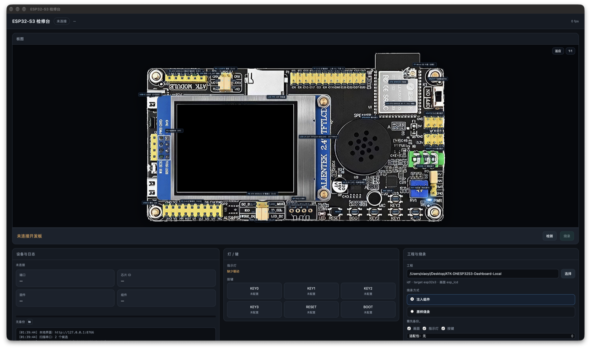

# ESP32-S3 检修台

macOS 桌面应用。连接 ESP32-S3 开发板，读取芯片信息与实时画面，显示板载 LED、KEY0–KEY3 状态，导入 ESP-IDF 工程，完成备份、注入组件、编译、烧录与回滚。



## 当前功能

| 模块 | 已实现 |
|---|---|
| 设备连接 | 枚举 CH340 / CP210x / 原生 USB；原生 USB 从描述符读取芯片 MAC，不复位芯片 |
| 板图 | ATK-DNESP32S3 渲染图、P1–P6 排针标注、6 个按键热区、LED / PWR 指示、画面窗口 |
| 画面 | 接收 RGB565 画面帧，显示在板图屏幕位；支持适应窗口、1:1、滚轮缩放、拖拽 |
| LED | 读取 GPIO 电平与 PWM 占空比；低电平点亮按 `active_low` 解释 |
| 按键 | 读取 KEY0–KEY3（XL9555 P17–P14），显示按下 / 松开；主机每 1.2 s 查询一次快照 |
| 工程导入 | zip / tar / tar.gz / tgz / 文件夹 / 单 bin；防 zip slip 与符号链接越界；识别最浅 ESP-IDF 工程根 |
| 注入烧录 | 组件复制到工作区副本的 `components/`，改副本 `CMakeLists.txt` 的 `EXTRA_COMPONENT_DIRS`，关闭 `MINIMAL_BUILD`；原工程不改 |
| 原样烧录 | 不注入组件，先整片擦除，再编译、烧录、二次读芯片 ID 校验；不要求备份 |
| 备份 | 快速备份只读到最后分区末尾；完整备份读整片；按芯片 MAC 隔离索引 |
| 回滚 | 稀疏备份先整片擦除再写镜像；空片备份只擦除；禁止跨芯片回滚 |
| 清理 | 开发板拔出满 1 小时后，删除该芯片备份、构建副本、导入工程和旧版 `projects_imported`；插回撤销；有任意串口设备在线时不执行 |
| 打包 | PyInstaller + Swift NSWindow/WKWebView；生成 `.app` 与 DMG；含 `esptool` 与备份种子 |

## 未实现与限制

| 项目 | 现状 |
|---|---|
| 检修台按键反控开发板 | `/api/key` 会发出 `{"cmd":"key","idx":N}`，但固件 `console_proto_set_cmd_cb()` 没有注册者，命令不会驱动 GPIO/XL9555。物理按键只能由开发板向 App 上报，App 不能反向下按。 |
| RESET / BOOT | 固件只采集 KEY0–KEY3；`CONFIG_KEY_READ_RESET=-1`，BOOT 没有采集项。界面保留这两个卡片与热区，状态显示“未配置”。 |
| 物理按键刷新 | XL9555 的输入端口只在主机 `console_info` 查询时读取；主机轮询间隔 1.2 s，因此状态最多延迟约 1.2 s。 |
| 无 LCD 的画面 | 原生 USB 下，用户工程暴露 `uint16_t *ui_framebuffer(void)` 时可直接读整帧，即使未接屏也能显示；没有该符号时只能截 `esp_lcd_panel_draw_bitmap`，无屏或无绘制调用就没有画面。 |
| 画面适配包 | `alientek` 适配包 `verified=false`，UI 下拉框不会出现；只有 `esp_lcd` 路径可用的工程能稳定采画面。 |
| 工程类型 | 只接受 ESP-IDF；Arduino / PlatformIO 明确拒绝。 |
| 运行平台 | macOS 12+，当前构建为 arm64；没有 Windows 版本。 |
| 签名 | ad-hoc 签名，未做 Apple 公证；首次打开如被 Gatekeeper 拦截，右键“打开”。 |

## 快速开始

### 使用打包版

1. 打开 `~/Desktop/ESP32-S3 检修台.dmg`，把 `ESP32-S3 检修台.app` 拖入“应用程序”。
2. 双击启动。窗口标题为“ESP32-S3 检修台”，界面由 App 内置 WKWebView 渲染，不打开浏览器。
3. 插好开发板，点左上“检测”。原生 USB 优先于 CH340。
4. 选择工程，按“备份 → 编译并烧录”或“原样烧录”操作。

数据目录：

```
~/Library/Application Support/ESP32-S3-Console-App/data/
├── backups/                 # 按芯片 MAC 的整片镜像与 index.json
├── workspace/               # 每次编译用的工作区副本；拔板满 1 小时清空
└── projects_imported/       # zip / tar 解压目录；拔板满 1 小时清空
```

旧版遗留在 `~/Library/Application Support/ESP32-S3-Console-App/projects_imported/` 的目录，也会在开发板拔出满 1 小时后清理。

### 从源码运行

```bash
cd "/Users/xiaoyi/个人/单片机/ESP-S3/Project/ESP32-S3-Console-App"
/Users/xiaoyi/.espressif/tools/python/v5.5.6/venv/bin/python backend/app.py
```

后端监听 `127.0.0.1:8765`，被占用时顺延到 8784；实际端口写入
`~/Library/Application Support/ESP32-S3-Console-App/port.txt`。

### 运行测试

```bash
/Users/xiaoyi/.espressif/tools/python/v5.5.6/venv/bin/python tests/test_backend.py
```

当前 7 组：CRC、混合流解析、烧录清单、组件注入、工程导入、IDF 预检、拔板清理。脚本不依赖 pytest，直接运行即可。

## 烧录流程

### 注入组件

1. 连接开发板，确认 `status=ready` 或 `connected_no_fw`。
2. 选择 ESP-IDF 工程目录或压缩包。
3. 勾选“画面 / 指示灯 / 按键”，选择适配包（当前无已验证适配包）。
4. 首次烧录先点“备份”。没有整片备份时，点“编译并烧录”会弹出备份确认；备份完成后自动继续，不需要再点一次。
5. 编译在 `workspace/<chip_id>/<工程名>_<时间戳>/` 内进行。
6. 组件注入到副本的 `components/`；副本 `CMakeLists.txt` 写入绝对路径 `EXTRA_COMPONENT_DIRS`，并注释 `MINIMAL_BUILD ON`。
7. 烧录完成后二次读取芯片 ID；一致才判定成功，随后重新握手。

### 原样烧录

不注入组件，不改工程。先 `erase_flash` 整片擦除，再编译、写入。该模式不要求备份。

### 回滚

“恢复原固件”只使用当前芯片 MAC 对应的备份。跨芯片没有备份时按钮不生效。稀疏备份先整片擦除，再写镜像；空片备份只擦除。

## 串口协议

上报口为 USB-Serial-JTAG 或 UART0，默认 921600。混合流：

```text
JSON 遥测行：以 \n 结尾，UTF-8
二进制画面：A5 5A | u32 len LE | u16 CRC16-CCITT | payload
```

画面 payload 由 `OP_PART(0x05)` 块和末块 `OP_END(0x00)` 组成，每块 1024 像素 RGB565。完整字段、命令、状态机和错误码见
[开发文档](docs/ESP32-S3-Console-App-开发文档.md)。

## 目录

```
ESP32-S3-Console-App/
├── backend/                       # 18 个 Python 模块
├── esp32_components/
│   ├── console_protocol/          # 公共串口协议层
│   ├── display_component/         # 画面采集
│   ├── led_read_driver/           # LED 只读采集
│   ├── key_read_driver/           # KEY0–KEY3 只读采集
│   └── screen_adapters/           # 画面适配包（alientek 未实测）
├── frontend-ui/                   # index.html + board.png
├── mac_bundle_packager/           # ConsoleShell.swift + build_app.sh + AppIcon
├── tests/                         # test_backend.py + fixture_project
├── docs/
│   ├── ESP32-S3-Console-App-开发文档.md
│   ├── board_pins.md
│   ├── verification.md
│   └── images/
├── requirements.txt
└── README.md
```

生成物不入库：`backups/`、`workspace/`、`projects_imported/`、`mac_bundle_packager/build/`、`tests/fixture_project/build/`、`__pycache__/`、`.DS_Store`。

## 打包

```bash
cd "/Users/xiaoyi/个人/单片机/ESP-S3/Project/ESP32-S3-Console-App"
./mac_bundle_packager/build_app.sh
```

脚本六步：清理 → PyInstaller（`--collect-all esptool`）→ 组装 `.app` → 复制前端 / 组件 / 图标 / 备份种子 → Swift 编译原生壳 → 写 `Info.plist`、ad-hoc 签名 → `hdiutil` 生成 DMG。

### 版本与发布规则

- 根目录 `VERSION` 是版本唯一来源，格式 `x.y.z`；`build_app.sh` 读取失败或格式不对时直接退出。
- 每次改动必须递增版本：修 bug 用 patch，新增功能用 minor。
- 每次改动完成后依次执行：更新 `VERSION` → 跑 `tests/test_backend.py` → 提交并 `git push origin main` → `./mac_bundle_packager/build_app.sh` → 发布 GitHub Release `vVERSION`，附带 DMG 与 macOS 截图。
- 当前只有 macOS 构建，Release 中没有 Windows 截图时如实标注，不用占位图。

打包前必须退出正在运行的 `ESP32-S3 检修台.app`；脚本会 `rm -rf build`。

产物：

- `mac_bundle_packager/build/ESP32-S3 检修台.app`
- `~/Desktop/ESP32-S3 检修台.dmg`

`.app` 通过四个环境变量固定资源路径：`CONSOLE_APP_HOME`、`CONSOLE_APP_FRONTEND`、`CONSOLE_APP_COMPONENTS`、`CONSOLE_APP_SEED_BACKUPS`。

## 文档

- [开发文档](docs/ESP32-S3-Console-App-开发文档.md)：架构、协议、组件、API、烧录、备份、打包、限制
- [板型引脚](docs/board_pins.md)：LED、KEY0–KEY3、RESET、BOOT 的实际连接
- [验收记录](docs/verification.md)：按日期保留的历史实测
